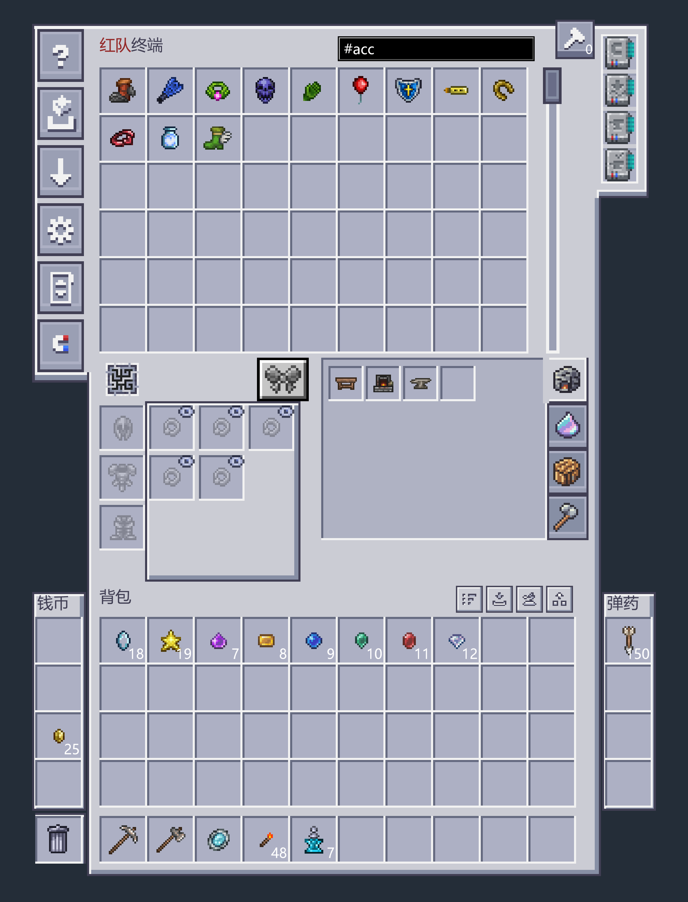
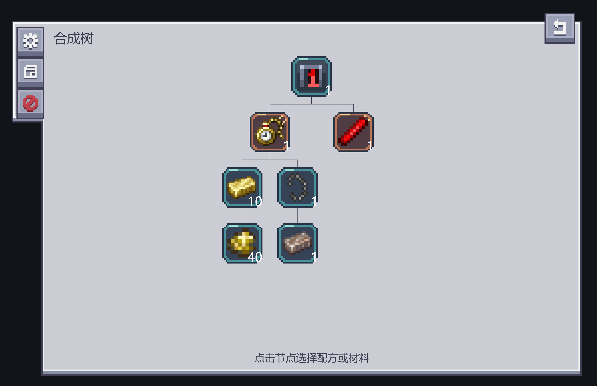
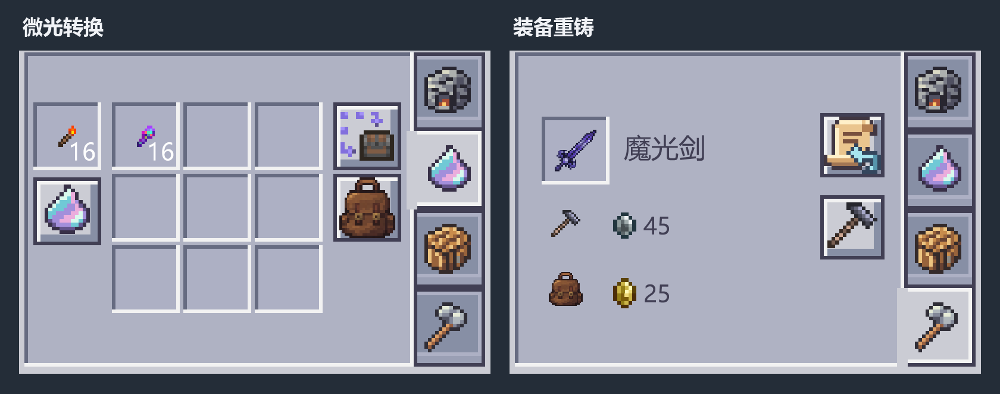

# AE: Beyond Dimensions

[简体中文（原文）](./README.md) · **English (machine translation)**

AE: Beyond Dimensions is a remote storage and autocrafting mod for Terraria’s tModLoader. Use the ME terminal to deposit and retrieve items remotely, plan multi-step crafting, and share inventory and crafting orders with teammates in multiplayer.

## Core features

### Storage and search

- **Side-by-side inventory and storage.** Your inventory and terminal storage appear side by side, so you can find materials and swap accessories in one view. Storage expands automatically as you deposit items.
- **Search filters.** Search by item name, Pinyin, or tag. For example, enter `#acc` to show accessories.
- **Grouped items and modifier selection.** The terminal groups items of the same type and displays their total count. Expand a stack of equipment to inspect the individual modifiers and take the piece you want.

### Crafting trees and missing materials

- **Crafting stations.** Place a Work Bench, Furnace, Iron Anvil, or another station in the terminal’s crafting station slots to use its recipes.
- **Planning a craft.** With Just Enough Items: Terraria Edition (JEI) installed, middle-click the item you want in the item list to preview a crafting plan. Expand the tree to see which intermediate items you can make from stock, which ingredients you still need to gather, and which crafting stations are missing.
- **Crafting and tracking shortages.** When the requirements are met, confirm once to craft everything from the intermediate items to the final product. If materials are missing, you can still place the order. Bookmark the missing materials to keep the current page open and track the available and required quantities in JEI’s bookmark panel.
- **Automatic completion and cancellation.** Deposit the missing materials and the order finishes automatically once all crafting requirements are met. You can cancel the entire order if your plans change.

### Shimmer and reforging

| Terminal upgrade | What it does |
| --- | --- |
| Shimmer card | Transform or decraft items with Shimmer directly in the terminal. |
| Standard reforging card | Reroll an item’s modifier at random. |
| Reforging upgrade card | Choose the modifier you want from the list available for that item. |

### Other upgrade cards

- **Magnet card.** Choose where new pickups go. Prioritize terminal storage, prioritize your inventory, or automatically store only item types already in the terminal.
- **Control panel card.** Open the Quality of Terraria control panel directly from the terminal when that mod is installed.

### Multiplayer team storage

- **Storage by controller or team.** In single player, each ME controller has its own inventory. In multiplayer, players on the same team color share inventory and orders. Each team color has its own storage.
- **Teammates can supply materials.** One player can queue an order and another can deposit the missing ingredients. The order completes automatically once all crafting requirements are met.

## Mod integration

| Mod | Supported features |
| --- | --- |
| Just Enough Items: Terraria Edition (JEI) | Preview crafting trees, queue orders with missing materials, and bookmark shortages to track progress. |
| Content mods such as Calamity | Use standard recipes registered through tModLoader. |
| Magic Storage | Import stored items into the ME terminal. |
| Quality of Terraria | Import stored items and open the mod’s control panel with the control panel card installed. |

## Multiplayer testing

An earlier two-client test covered teammates supplying a crafting order. One player ordered three Torches. Both clients showed a shortage of one Wood and one Gel. After a teammate supplied the ingredients, both clients showed three Torches in storage and an empty order queue.

## Sharing and reuse

You’re welcome to write about **AE: Beyond Dimensions** or share a link to it. Please credit **baixiaoxiao & Codex** and link to the official Steam Workshop page or GitHub repository so players can find the mod and its updates.

**Original artwork** is available under **CC BY-NC-SA 3.0**. You may share, reuse, and adapt it for noncommercial purposes. Please credit **baixiaoxiao & Codex** and include links to the source and license. If you publish an adaptation, describe your changes and distribute it under the same license. [Full artwork license](https://creativecommons.org/licenses/by-nc-sa/3.0/)

**Third-party assets** retain their respective licenses. Textures from Applied Energistics 2 and AE2 Wireless Terminal Library are also licensed under CC BY-NC-SA 3.0. Please retain the applicable upstream artist credits when reusing them. The mod’s source code is public on GitHub. Redistribution terms for the original code will be specified separately.

## Reporting an issue

