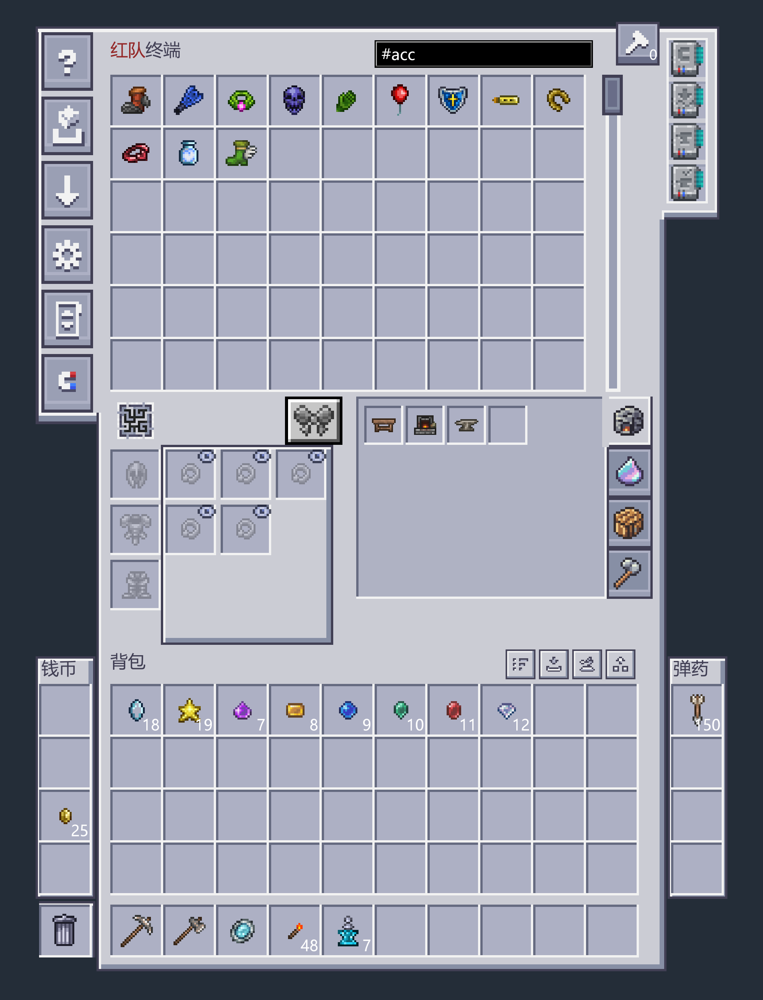
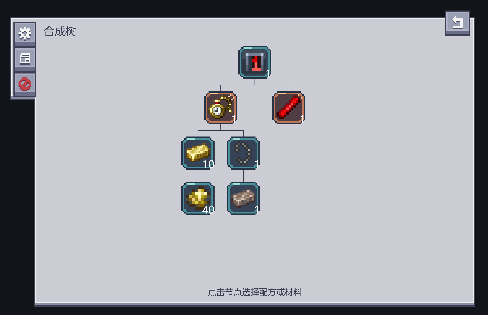
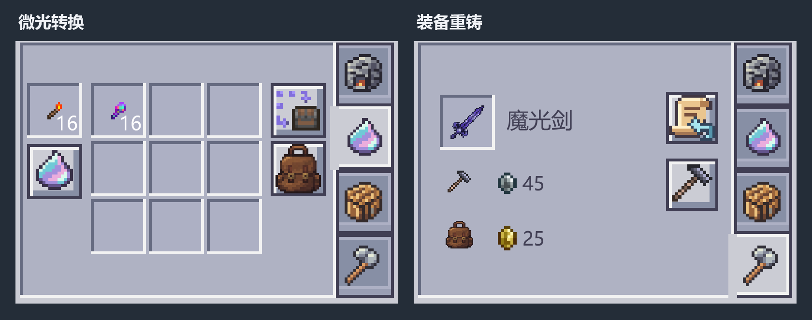

# AE 超越维度 (AE: Beyond Dimensions)

**简体中文（原文）** · [English (machine translation)](./README.en.md)

面向《泰拉瑞亚》tModLoader 的远程仓储与自动合成模组。通过 ME 终端，你可以远程存取物品、规划多级合成，并在多人游戏中与同队玩家共享库存和订单。

## 核心功能

### 存储与搜索

- **并排显示与自动扩容**　背包与仓库并排显示，可以在同一界面查找材料、更换饰品。仓库容量随物品存入自动扩容。
- **多条件搜索**　支持按物品名称、拼音和标签筛选。例如，输入 `#acc` 可筛选饰品。
- **物品聚合与词缀挑选**　同类物品合并计数。同款装备归入同一格，展开后可以查看不同词缀，挑出需要的那一件。

### 合成树与缺料

- **内置制作站**　将工作台、熔炉、铁砧等放入终端的工作方块栏，即可使用对应配方。
- **合成树规划**　搭配 Just Enough Items: Terraria Edition（JEI）时，用鼠标中键点击物品列表中的成品，即可查看合成计划。展开合成树，可以看到哪些中间物品能用现有库存制作、哪些基础材料仍需外出收集，以及还缺哪些制作站。
- **一键合成与缺料收藏**　条件齐全时，确认一次即可完成从中间材料到成品的所有制作步骤。材料不足时也可以先下单，再点击「收藏缺失」。当前页面会保留，JEI 收藏栏会实时显示每种缺料的已有量与需求量。
- **自动完成与撤销**　将缺失材料存入终端，制作条件齐全后，订单会自动完成。改变计划时，可以整组撤销订单。

### 微光与重铸

| 终端升级卡 | 用途 |
| --- | --- |
| 微光卡 | 在终端内直接进行微光转化与分解。 |
| 普通重铸卡 | 随机重铸装备。 |
| 重铸升级卡 | 从当前装备可用的词缀列表中直接选择目标词缀。 |

### 其他升级卡

- **磁卡**　设置新拾取物品的去向，可选择「终端优先」「背包优先」或「仅自动存入仓库已有的同类物品」。
- **总控卡**　安装《更好的体验》后，可从终端直接打开该模组的总控面板。

### 多人队伍仓库

- **存储隔离与共享**　单人模式下，每台 ME 控制器独立存储。多人模式下，同一颜色的队伍共享库存与订单，不同颜色的队伍各有自己的仓库。
- **队友协作补料**　一名玩家可以先提交缺料订单，另一名队友收集材料后直接存入终端。制作条件满足时，订单就会自动完成。

## 模组兼容与联动

| 联动模组 | 支持功能 |
| --- | --- |
| Just Enough Items: Terraria Edition（JEI） | 合成树预览、缺料下单、缺失物品收藏与进度显示。 |
| 灾厄等内容模组 | 支持通过 tModLoader 注册的常规配方。 |
| Magic Storage | 支持将仓储物品导入 ME 终端。 |
| 《更好的体验》 | 支持导入仓储物品，安装总控卡后还可打开总控面板。 |

## 版本与测试说明

过往双客户端联机测试覆盖了队友协作补料。测试中，一名玩家提交了 3 支火把的订单，两端都显示还缺 1 个木材和 1 个凝胶。队友补齐材料后，两端均显示库存中有 3 支火把，待完成订单清零。

## 转载与使用

欢迎介绍或分享 **AE 超越维度**。请注明作者 **baixiaoxiao & Codex**，并附上官方工坊或 GitHub 链接，方便玩家找到原作和更新。

**原创美术**采用 **CC BY-NC-SA 3.0**。欢迎出于非商业目的转载、使用或改编。分享时请署名 **baixiaoxiao & Codex**，保留来源和许可链接；如果改过，请说明改动，并在发布改编作品时沿用同一许可。[美术许可全文](https://creativecommons.org/licenses/by-nc-sa/3.0/)

**第三方素材**沿用各自的许可。来自 Applied Energistics 2 和 AE2 Wireless Terminal Library 的相关贴图同样采用 CC BY-NC-SA 3.0，使用时请保留对应上游作者的署名。模组源代码已在 GitHub 公开，原创代码的再分发许可将另行说明。
